# NDT Toolbox

Non-destructive testing (NDT) methods are pretty neat and I figured it wouldnt hurt to get familar with them. The methods are built from their physics up, and to make the results something you can play with. Every page in the app is a forward model of a real inspection. You set up the part, the probe or source, and the defects, and you watch the signals and images respond. The same models are available as a Python library and from a small command-line tool for day-to-day calculations.

The methods covered are:

1. ultrasonic pulse-echo testing and TOFD
2. phased arrays (full-matrix capture and the total focusing method)
3. eddy current, including pulsed eddy current
4. digital radiography and computed tomography
5. active thermography
6. guided (Lamb and SH) waves
7. probability of detection (POD)

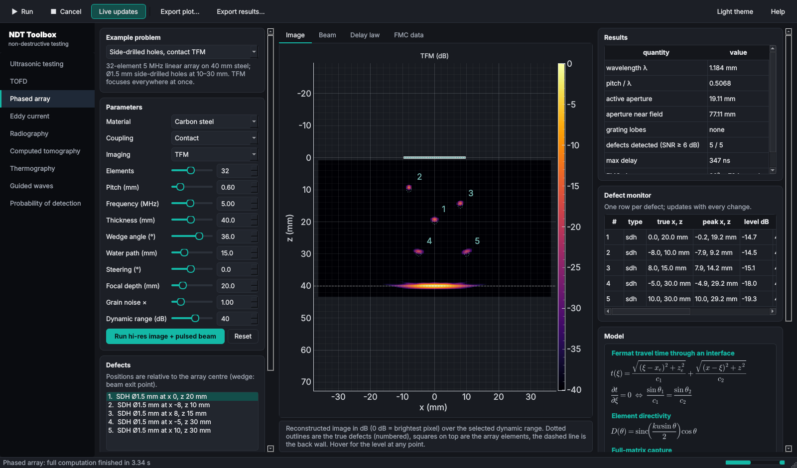

## Install and run

```bash
git clone https://github.com/gaschenb/Non-Destructive-Testing.git
cd Non-Destructive-Testing
pip install -r requirements.txt      # numpy, scipy, matplotlib, PyQt5, pyqtgraph
pip install -e .                     # installs the ndttoolbox-gui and ndttoolbox commands
```

You need Python 3.9 or newer. Then start the app or the command-line tool:

```bash
ndttoolbox-gui                       # the application (add --dark for the dark theme)
ndttoolbox --help                    # the command-line tool
```

If you'd rather not install the package, `python -m ndttoolbox.gui` and `python -m ndttoolbox` do the same thing from the repository folder.

## Features

1. Nine workspaces, one per method, each with between five and eight worked example problems.
2. Live sliders. The fast part of each model reruns as you drag. The expensive parts (C-scans, 3-D heat diffusion, pulsed beams, model-assisted POD) run in a background thread, so the window never freezes.
3. Your own defects. On seven of the pages the example problem only fills in a starting defect list. You can add, duplicate, edit and remove defects there.
4. A defect monitor that updates with every change. For each defect it shows what the inspection actually measured (position or depth, amplitude, SNR, size) and whether it counts as detected.
5. The governing equations for each page, typeset in the app.
6. Hover read-outs on every plot and image, plus a short note under each tab on what you're looking at.
7. Light and dark themes, PNG export of any view and CSV export of the results table.
8. A command-line tool for the quick calculations I keep needing: beam spread, interface coefficients, skin depth, half-value layers, Lamb dispersion, TOFD depths and POD fits.

## Methods

### Ultrasonic testing

1. Defects are treated as Kirchhoff scatterers in a Gaussian-weighted piston beam, and the echoes are summed band by band over the probe spectrum [1, 2].
2. Beam spreading uses the on-axis piston pressure and the Seki diffraction correction [3].
3. Attenuation follows a causal power law with the matching velocity dispersion [4]. Grain noise is added with a backscatter level that depends on frequency and grain size [1].
4. Reflection, transmission and mode conversion at fluid–solid and solid–solid interfaces come from the Zoeppritz equations [5].
5. The DGS diagram, DAC and equivalent reflector size follow the standard flat-bottom-hole scaling [1].

### TOFD

1. The model generates the lateral wave, the diffracted signals from the upper and lower crack tips (with the phase flip between them), the back wall and the shear arrivals [6].
2. Tip depth comes from d = √((ct/2)² − S²). The page also estimates the dead zone and the depth resolution [6].

### Phased arrays

1. Rays are traced through the wedge or water interface by Fermat's principle, solved with a Newton iteration.
2. Full-matrix capture includes element directivity and interface transmission [7].
3. Images are made with the total focusing method [8], the phase-coherence factor [9], plane-wave compounding [10] and sector scans with focal laws.
4. The page also predicts grating lobes and the aperture near field [7].

### Eddy current

1. Coil impedance over layered conductors uses the Dodd–Deeds solution, with a multilayer admittance recursion for coatings and plates [11].
2. Defect signals come from Auld's reciprocity relation [12], using a quasi-static internal field for voids and a dipole-layer model for thin cracks. I checked the sign and scale against the exact layered solution for a thin perturbed layer.
3. Pulsed eddy current is computed in the Laplace domain and inverted with the Gaver–Stehfest algorithm [13].

### Radiography and CT

1. Attenuation combines Klein–Nishina Compton scattering [14] with photoelectric and coherent terms, including K-edges, that I fitted to NIST XCOM [15].
2. X-ray tube spectra use the Kramers continuum [16] plus tungsten characteristic lines and filtration. Ir-192, Se-75 and Co-60 are included as gamma sources.
3. The detector is CsI with energy-dependent absorption and Swank noise [17]. Scatter build-up, geometric and detector unsharpness and Poisson noise are all included.
4. Wire IQIs follow ISO 19232-1 [18] and SNR_N follows ISO 17636-2 [19]. Wire and defect visibility use the Rose criterion d′ ≥ 5 [20].
5. CT uses polychromatic parallel-beam projections, filtered back-projection with Ram-Lak, Shepp–Logan or Hann filters, and beam-hardening linearisation [21].

### Thermography

1. The 1-D model uses thermal quadrupoles for multilayer stacks with interface resistances [22], inverted with Gaver–Stehfest [13].
2. The 3-D model is a finite-volume heat-diffusion solver (locally one-dimensional, backward Euler) with anisotropic conductivity.
3. Processing includes absolute contrast, thermographic signal reconstruction with depth from the peak of the second log-derivative [23], pulsed-phase thermography [24] and lock-in phase.

### Guided waves

1. Rayleigh–Lamb dispersion is traced in the (k, ω) plane, which keeps the mode labels unambiguous and captures backward waves. SH modes are included [25].
2. The page also finds the S1 zero-group-velocity point used for local thickness resonance [26].
3. Tone bursts are propagated dispersively. The long-range screening model includes notch reflection and mode conversion [25].

### Probability of detection

1. Everything follows MIL-HDBK-1823A [27].
2. For signal-response (â vs a) data, the page fits a censored (Tobit) regression and gets the lower bound and a90/95 from the delta method [27, 28].
3. Hit/miss data are fitted with logit, probit, cloglog or loglog links, with likelihood-ratio confidence bounds [27].
4. The page also computes the false-call probability and the ROC curve. Model-assisted POD runs the ultrasonic and eddy-current models with random defect orientation, position and lift-off.

## Results and examples

These screenshots are produced by `examples/gallery.py` from the built-in example problems.

| B-scan of flat-bottom holes | Immersion C-scan of a titanium forging |
|---|---|
| 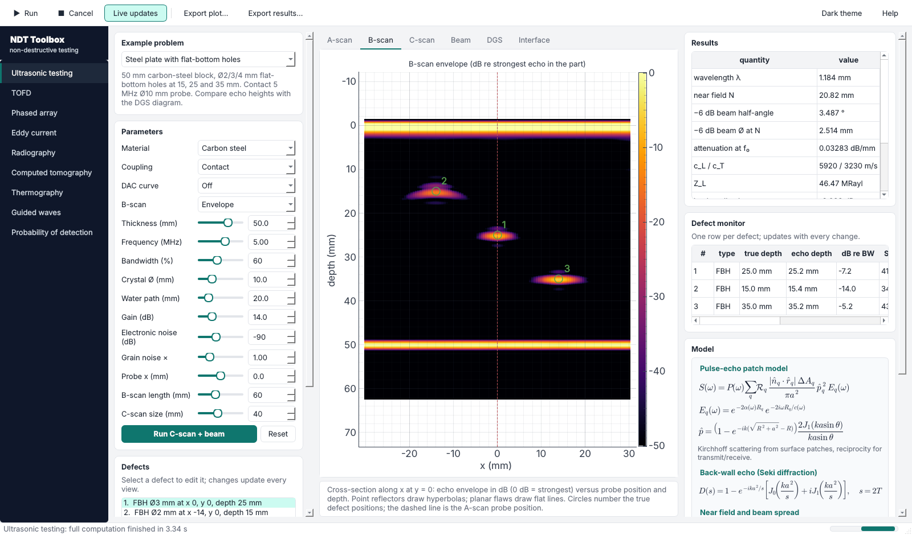 | 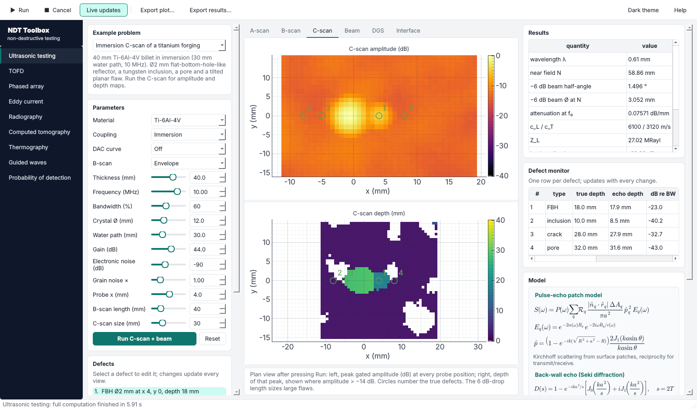 |

| DGS diagram | TOFD D-scan of an embedded crack |
|---|---|
| 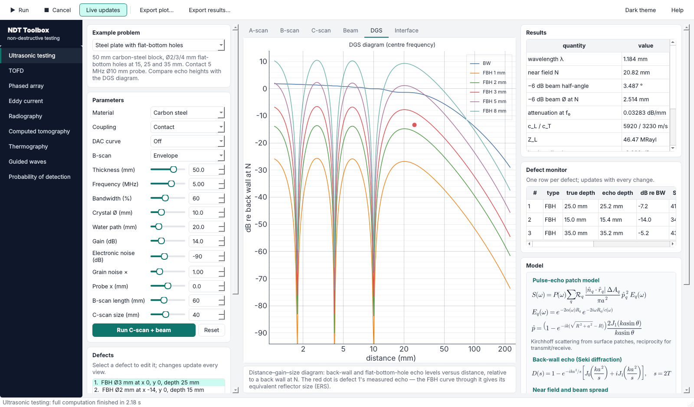 | 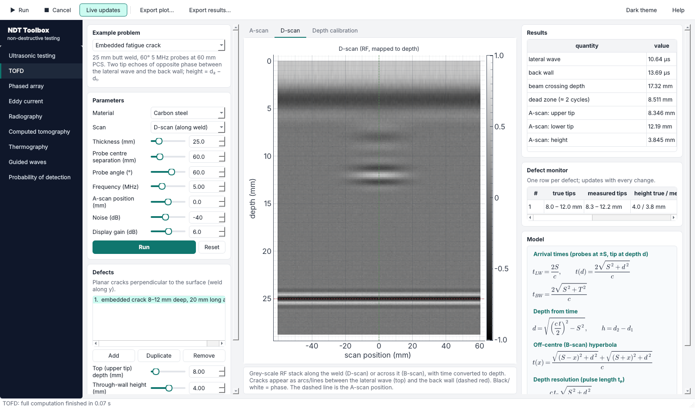 |

| Sectorial scan through a wedge | Normalised eddy-current impedance plane |
|---|---|
| 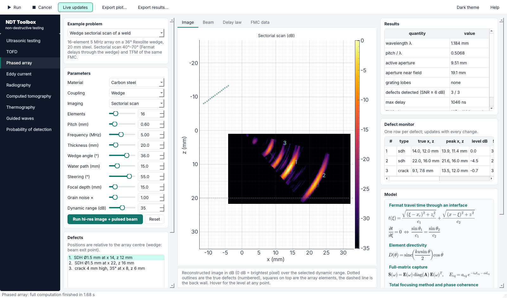 | 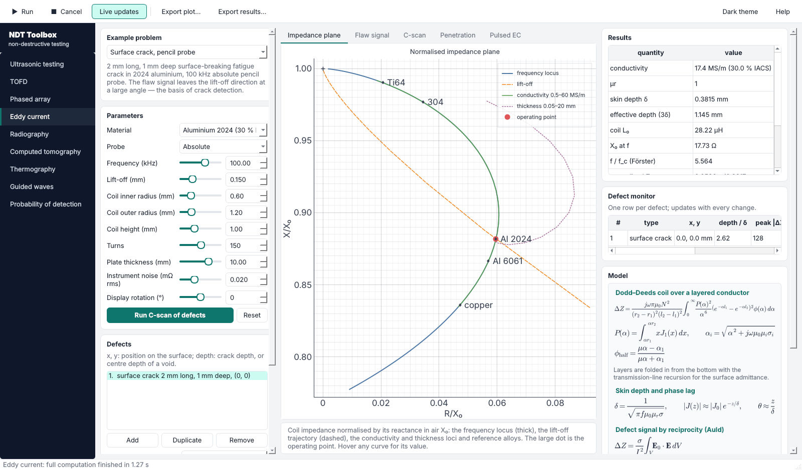 |

| Pulsed eddy-current decay | Weld radiograph with wire IQI |
|---|---|
| 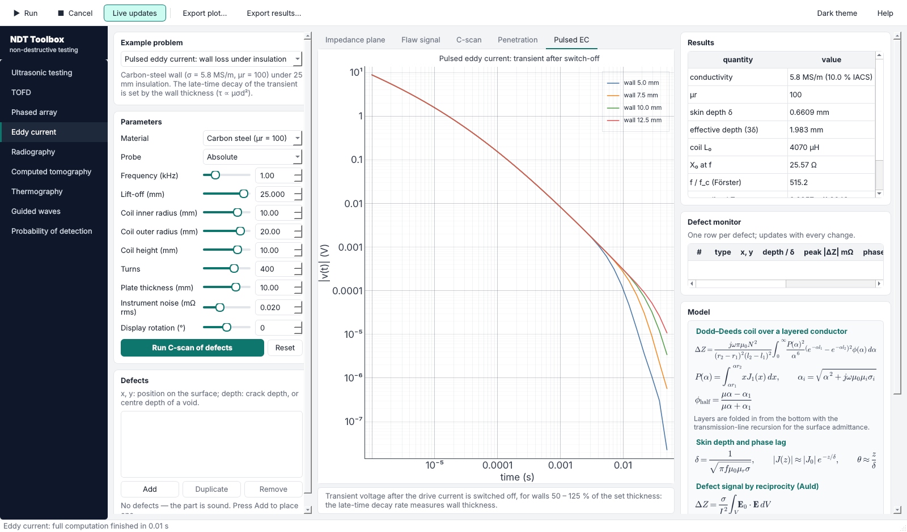 | 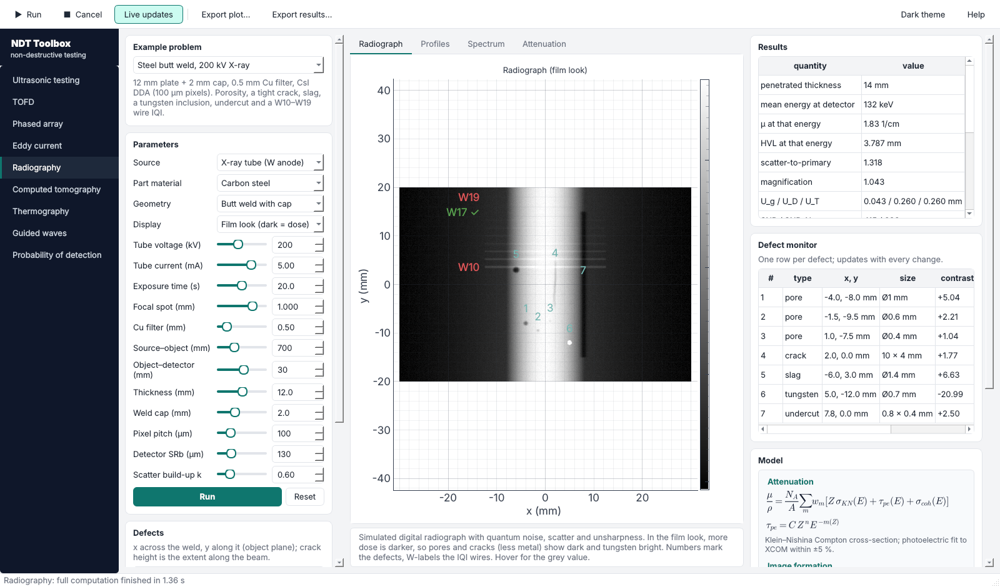 |

| Spectrum at the detector | CT of a steel pipe (beam hardening visible) |
|---|---|
| 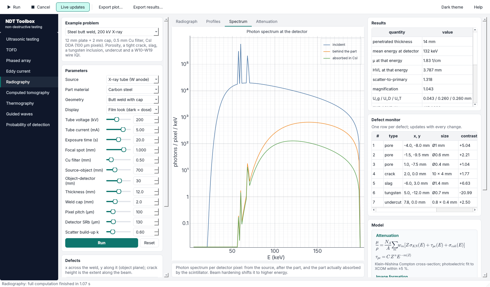 | 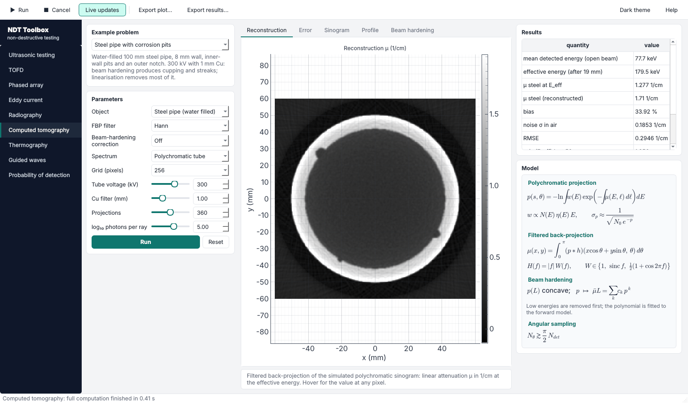 |

| CT of an aluminium casting | Thermal contrast of CFRP delaminations |
|---|---|
| 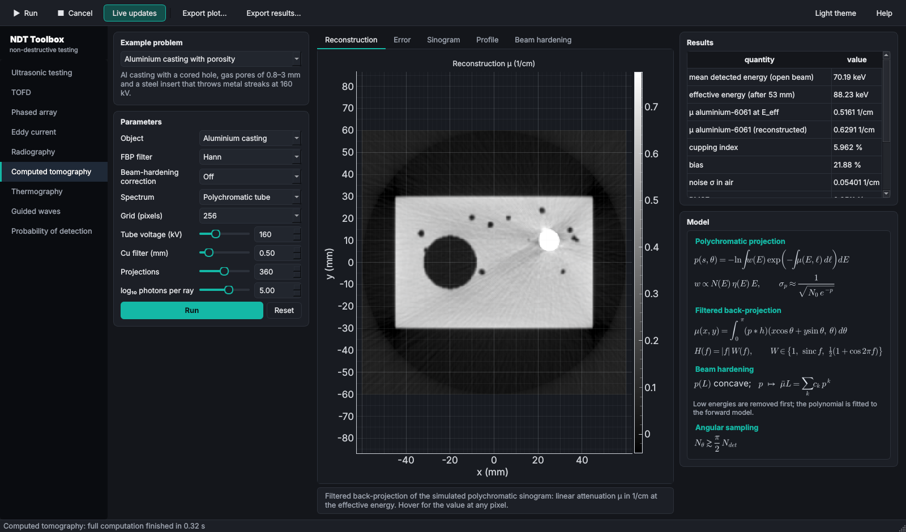 | 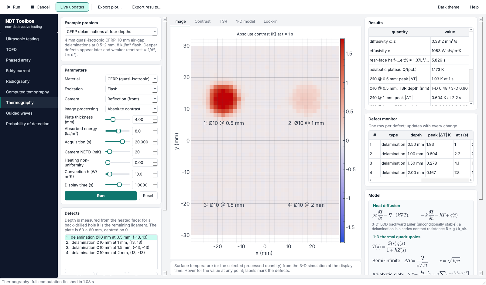 |

| TSR under non-uniform heating | Lamb dispersion in aluminium |
|---|---|
| 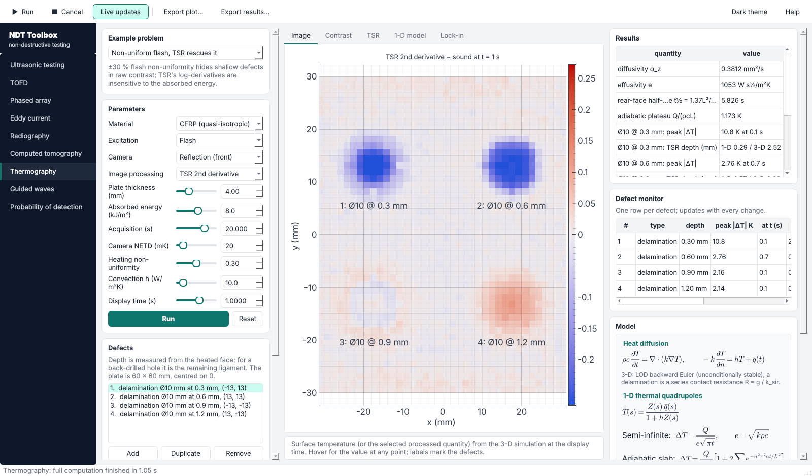 | 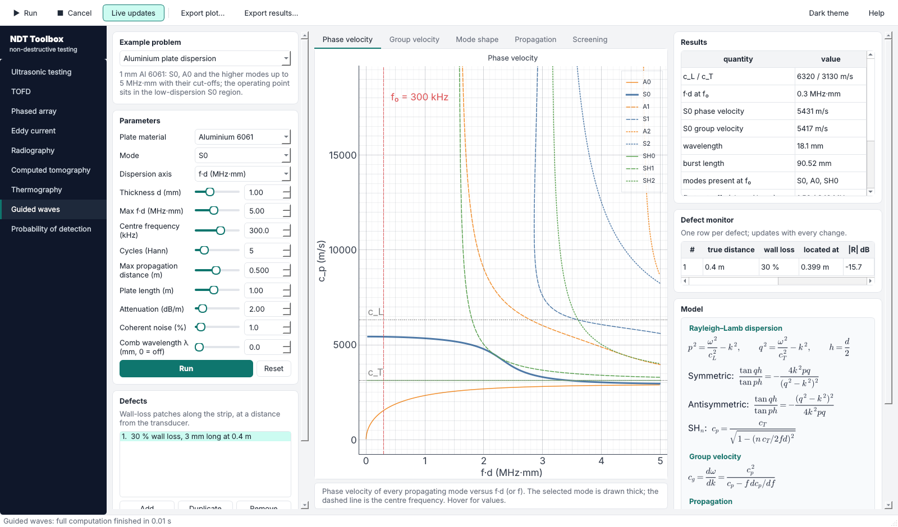 |

| S1 zero-group-velocity point in steel | Long-range SH0 screening |
|---|---|
| 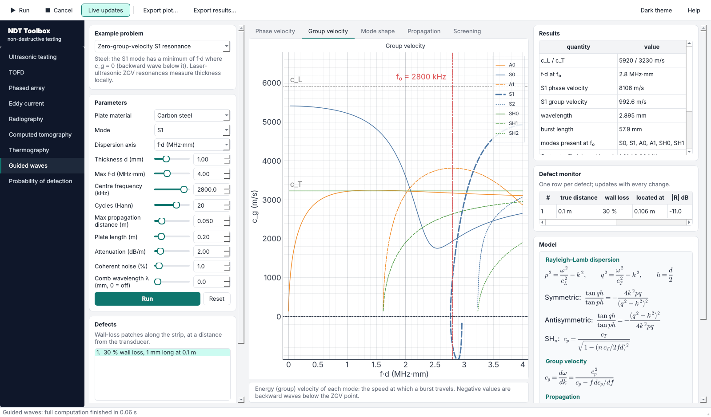 | 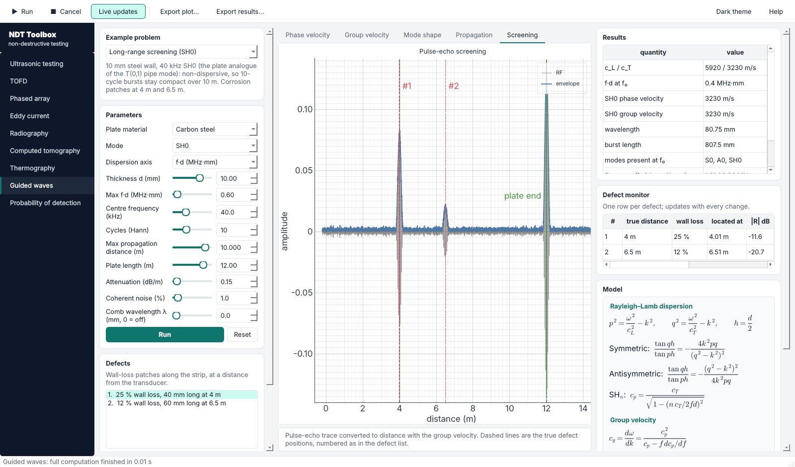 |

| â vs a with censoring | Hit/miss POD with false calls |
|---|---|
| 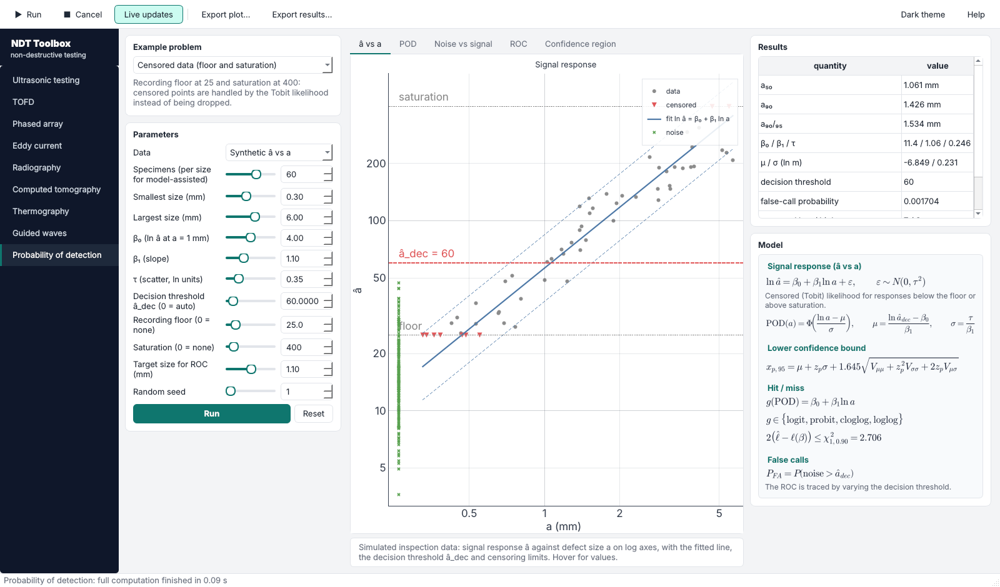 | 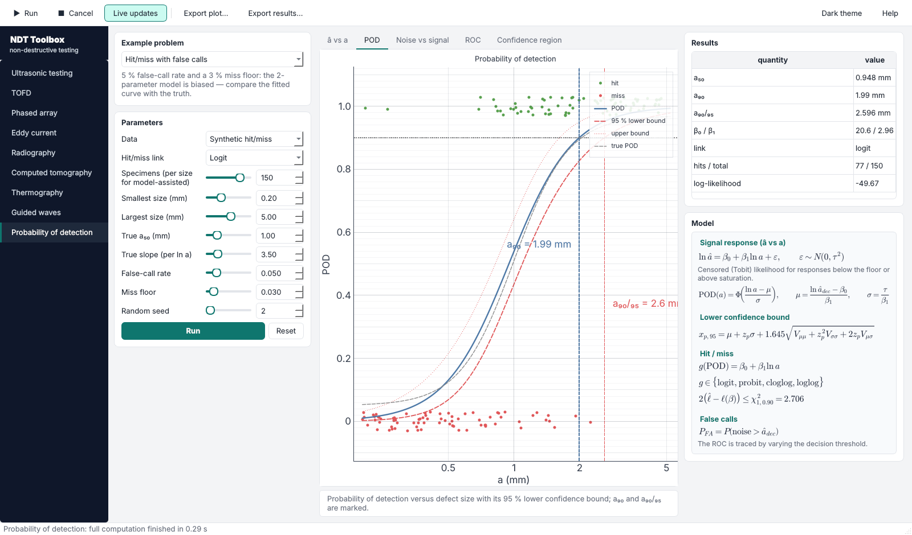 |

The example problems on each page are:

1. **Ultrasonic testing:** flat-bottom holes, an SDH reference block with DAC, an immersion titanium forging, a lamination, a coarse-grained austenitic weld, CFRP impact damage and a tilted planar flaw.
2. **TOFD:** an embedded fatigue crack, a toe crack, a root crack, two cracks in a thick section, and the near-surface dead zone.
3. **Phased array:** SDHs with contact TFM, a vertical crack (TFM vs phase coherence), a wedge S-scan of a weld, grating lobes, plane-wave compounding and immersion.
4. **Eddy current:** a surface crack, subsurface voids, second-layer corrosion, conductivity sorting, thin-sheet gauging, pulsed eddy current under insulation and a ferromagnetic weld toe crack.
5. **Radiography:** a 200 kV weld, Ir-192 on a 25 mm weld, an aluminium step wedge, crack orientation, geometric unsharpness and Co-60 on 80 mm of steel.
6. **Computed tomography:** a corroded steel pipe with and without beam-hardening correction, a porous casting, a CFRP panel with a Ti insert, angular undersampling, photon starvation and a monochromatic reference.
7. **Thermography:** a CFRP depth ladder, the aspect-ratio limit, aluminium back-drilled holes, steel wall thinning, water ingress in GFRP, step heating, non-uniform flash and transmission mode.
8. **Guided waves:** aluminium dispersion, A0 dispersion over distance, S0 above the knee, SH0 long-range screening, A0 wall-loss screening, comb-transducer mode selection and the S1 ZGV resonance.
9. **POD:** â vs a, censored data, a small sample, hit/miss, hit/miss with false calls, and model-assisted POD for ultrasonic and eddy-current cracks.

## GUI

The window has three columns.

1. **Left:** pick the example problem, then adjust the parameters. On the inspection pages the defect list sits below the parameters.
2. **Centre:** the result views in tabs, with a one-line note under the tabs explaining the current view.
3. **Right:** the results table, the defect monitor and the typeset equations for the page.

Hover over any plot to get a cross-hair with the axis values and the value of each curve, or the pixel value of an image. Mouse-wheel and drag zoom work as usual, but you can't zoom out past the point where the whole data set or image fits. Press **Run** (Ctrl+R) to compute the expensive parts; some pages start these on their own a moment after you stop changing things. The toolbar exports the current view as PNG and the results table as CSV, and toggles the dark theme (Ctrl+T).

## CLI

```bash
ndttoolbox materials                                    # material database
ndttoolbox beam --material steel --freq 5e6 --diameter 10e-3
ndttoolbox interface --from water --to steel            # R, T and critical angles
ndttoolbox ascan --fbh 2e-3 --depth 30e-3 --out ascan.csv
ndttoolbox ers --thickness 0.1 --depth 0.06 --ratio-db -26
ndttoolbox tofd --thickness 25e-3 --pcs 60e-3 --times 10.6e-6 11.2e-6
ndttoolbox eddy --sigma-iacs 30 --freq 100e3            # standard depth of penetration
ndttoolbox xray --material steel --kev 100 662 1250     # μ, HVL and TVL
ndttoolbox lamb --material aluminium-6061 --thickness 1e-3 --out lamb.csv
ndttoolbox thermal --material cfrp --tstar 0.8 --fblind 0.1
ndttoolbox pod data.csv --threshold 60 --scale 1e-3     # columns a, ahat (or --hitmiss: a, hit)
```

Inputs are in SI units unless the option name says otherwise.

## Library use

```python
from ndttoolbox.core import ultrasonics as ut, guided_waves as gw, pod

s = ut.UTSetup(material="steel", thickness=50e-3, probe=ut.Probe(f0=5e6, diameter=10e-3))
t, a_scan = ut.ascan(s, [ut.Flaw("fbh", x=0, z=30e-3, size=2e-3)])

d = gw.lamb_dispersion("aluminium-6061", 1e-3, f_max=5e6)
print(gw.phase_velocity_at(d, "S0", 300e3), gw.zgv_frequency(d, "S1"))

a, ahat = pod.synthetic_ahat(n=60)
print(pod.ahat_vs_a(a, ahat, threshold=60).a90_95)
```

## Layout

```
ndttoolbox/
  core/          materials, signals, ultrasonics, phased_array, eddy_current,
                 radiography, thermography, guided_waves, pod
  gui/           application, workspace framework, one module per page
  cli.py         command-line tool
examples/
  gallery.py     regenerates the figures in docs/figures
docs/figures/    screenshots used in this README
```
## Citations

1. J. Krautkrämer and H. Krautkrämer, *Ultrasonic Testing of Materials*, 4th ed. Berlin: Springer, 1990.
2. L. W. Schmerr, *Fundamentals of Ultrasonic Nondestructive Evaluation: A Modeling Approach*, 2nd ed. Cham: Springer, 2016.
3. H. Seki, A. Granato and R. Truell, "Diffraction effects in the ultrasonic field of a piston source and their importance in the accurate measurement of attenuation," *J. Acoust. Soc. Am.*, vol. 28, no. 2, pp. 230–238, 1956.
4. T. L. Szabo, "Time domain wave equations for lossy media obeying a frequency power law," *J. Acoust. Soc. Am.*, vol. 96, no. 1, pp. 491–500, 1994.
5. K. Aki and P. G. Richards, *Quantitative Seismology*, 2nd ed. Sausalito, CA: University Science Books, 2002.
6. M. G. Silk and B. H. Lidington, "The potential of scattered or diffracted ultrasound in the determination of crack depth," *Non-Destructive Testing*, vol. 8, no. 3, pp. 146–151, 1975.
7. B. W. Drinkwater and P. D. Wilcox, "Ultrasonic arrays for non-destructive evaluation: A review," *NDT & E International*, vol. 39, no. 7, pp. 525–541, 2006.
8. C. Holmes, B. W. Drinkwater and P. D. Wilcox, "Post-processing of the full matrix of ultrasonic transmit–receive array data for non-destructive evaluation," *NDT & E International*, vol. 38, no. 8, pp. 701–711, 2005.
9. J. Camacho, M. Parrilla and C. Fritsch, "Phase coherence imaging," *IEEE Trans. Ultrason., Ferroelectr., Freq. Control*, vol. 56, no. 5, pp. 958–974, 2009.
10. G. Montaldo, M. Tanter, J. Bercoff, N. Benech and M. Fink, "Coherent plane-wave compounding for very high frame rate ultrasonography and transient elastography," *IEEE Trans. Ultrason., Ferroelectr., Freq. Control*, vol. 56, no. 3, pp. 489–506, 2009.
11. C. V. Dodd and W. E. Deeds, "Analytical solutions to eddy-current probe-coil problems," *J. Appl. Phys.*, vol. 39, no. 6, pp. 2829–2838, 1968.
12. B. A. Auld and J. C. Moulder, "Review of advances in quantitative eddy current nondestructive evaluation," *J. Nondestruct. Eval.*, vol. 18, no. 1, pp. 3–36, 1999.
13. H. Stehfest, "Algorithm 368: Numerical inversion of Laplace transforms," *Commun. ACM*, vol. 13, no. 1, pp. 47–49, 1970.
14. O. Klein and Y. Nishina, "Über die Streuung von Strahlung durch freie Elektronen nach der neuen relativistischen Quantendynamik von Dirac," *Z. Phys.*, vol. 52, pp. 853–868, 1929.
15. M. J. Berger, J. H. Hubbell, S. M. Seltzer, J. Chang, J. S. Coursey, R. Sukumar, D. S. Zucker and K. Olsen, *XCOM: Photon Cross Sections Database*, NIST Standard Reference Database 8 (XGAM). Gaithersburg, MD: NIST.
16. H. A. Kramers, "On the theory of X-ray absorption and of the continuous X-ray spectrum," *Phil. Mag.*, vol. 46, pp. 836–871, 1923.
17. R. K. Swank, "Absorption and noise in x-ray phosphors," *J. Appl. Phys.*, vol. 44, no. 9, pp. 4199–4203, 1973.
18. ISO 19232-1:2013, *Non-destructive testing — Image quality of radiographs — Part 1: Determination of the image quality value using wire-type image quality indicators*. Geneva: ISO, 2013.
19. ISO 17636-2:2013, *Non-destructive testing of welds — Radiographic testing — Part 2: X- and gamma-ray techniques with digital detectors*. Geneva: ISO, 2013.
20. A. Rose, "The sensitivity performance of the human eye on an absolute scale," *J. Opt. Soc. Am.*, vol. 38, no. 2, pp. 196–208, 1948.
21. A. C. Kak and M. Slaney, *Principles of Computerized Tomographic Imaging*. New York: IEEE Press, 1988.
22. D. Maillet, S. André, J.-C. Batsale, A. Degiovanni and C. Moyne, *Thermal Quadrupoles: Solving the Heat Equation through Integral Transforms*. Chichester: Wiley, 2000.
23. S. M. Shepard, J. R. Lhota, B. A. Rubadeux, D. Wang and T. Ahmed, "Reconstruction and enhancement of active thermographic image sequences," *Opt. Eng.*, vol. 42, no. 5, pp. 1337–1342, 2003.
24. X. Maldague and S. Marinetti, "Pulse phase infrared thermography," *J. Appl. Phys.*, vol. 79, no. 5, pp. 2694–2698, 1996.
25. J. L. Rose, *Ultrasonic Guided Waves in Solid Media*. Cambridge: Cambridge University Press, 2014.
26. C. Prada, D. Clorennec and D. Royer, "Local vibration of an elastic plate and zero-group velocity Lamb modes," *J. Acoust. Soc. Am.*, vol. 124, no. 1, pp. 203–212, 2008.
27. U.S. Department of Defense, *MIL-HDBK-1823A: Nondestructive Evaluation System Reliability Assessment*, 2009.
28. A. P. Berens, "NDE reliability data analysis," in *ASM Handbook, Vol. 17: Nondestructive Evaluation and Quality Control*. Materials Park, OH: ASM International, 1989, pp. 689–701.
